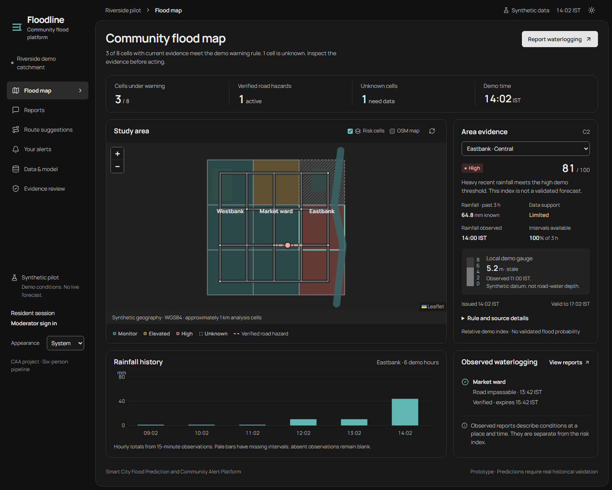

# Floodline — Smart City Flood Platform

A working CAA prototype built from the supplied implementation pipeline. The
dashboard leads with an interactive map and ward evidence, followed by community
reports, route suggestions, opt-in alerts and authenticated moderation.

**This pilot is synthetic.** Its three wards, rainfall, gauges, roads and event
labels are invented development fixtures. The displayed index is relative
susceptibility and threshold evidence, not a validated flood probability. Alerts
use a simulated in-app adapter; no SMS or email is sent.

Source: [Godavenger/floodline-caa](https://github.com/Godavenger/floodline-caa).
The [completion checklist](docs/REMAINING_TASKS.md) lists the remaining team,
assessment and real-pilot tasks with owners and completion evidence.

Use the moon/sun button in the header to switch appearance. The navigation's
**Appearance** selector offers **System**, **Light** and **Dark**. The default
follows your device; a manual choice is remembered across reloads and tabs.
Maps, charts, status messages, forms and dialogs follow the selected theme.

## Start on Windows

Prerequisites: Python 3.12+ and internet access for the first dependency setup.
The working folder and [demo ZIP](https://github.com/Godavenger/floodline-caa/releases)
contain the bundled interface and run without Node or npm. Node 22.12+ and npm are needed only
to rebuild the interface; Chrome or Edge is needed for browser verification.
No API keys or PostgreSQL are needed for the local demo.

A GitHub clone contains source. Install Node 22.12+ and npm, then run
`start.bat -Rebuild` once to install frontend dependencies and build its interface.
After that, ordinary `start.bat` uses the built interface.

Double-click **start.bat**, or run it from this folder:

~~~powershell
.\start.bat
~~~

The dashboard opens in your browser when ready. The default address is
**http://127.0.0.1:8000**; if that port is occupied, the launcher selects the next
available port and prints its address. Stop the server with Ctrl+C.
The launcher checks dependencies, uses the bundled interface, backs up an
existing local database, applies migrations and generates the synthetic
evaluation before starting FastAPI. It preserves reports and subscriptions.
The start.cmd alias continues to work. Both wrappers invoke PowerShell with a
process-local execution setting; no global Windows script policy changes.

Missing Python dependencies are installed automatically into .venv. To retry
or explicitly reinstall the pinned dependencies with internet access:

~~~powershell
.\start.bat -Install
~~~

After editing the interface source, rebuild it with Node and npm:

~~~powershell
.\start.bat -Rebuild
~~~

The -SkipBuild option requires the bundled interface and remains supported.
The -PrepareOnly option prepares everything without starting a server;
-Port 8001 requests that specific port, and -NoBrowser prevents automatic browser
opening. On failure, an interactive launcher window stays open and shows the
error. Detailed startup logs are saved in .runtime/launcher-logs/.
The default moderator login is **moderator / floodline-demo**, shown in the local sign-in
form. To change it, copy .env.example to .env and set ADMIN_PASSWORD; the
launcher reads these settings without executing their contents.

## Manual setup / macOS and Linux

~~~bash
python -m venv .venv
source .venv/bin/activate
python -m pip install -r backend/requirements.txt
cd frontend
npm ci
npm run build
cd ..
python -m backend.floodline migrate
python -m backend.floodline evaluate
python -m backend.floodline serve
~~~

On Windows, use the .venv\Scripts\python.exe interpreter. Environment variables
configure the app; .env loading is provided by the Windows launcher. The local
default is SQLite. PostgreSQL/PostGIS preparation is described in
[the runbook](docs/DEMO_RUNBOOK.md); that optional path has not been exercised on
this machine.

## Verify the pipeline

~~~powershell
.\start.bat -PrepareOnly -Verify
.\.venv\Scripts\python.exe scripts/verify_launcher.py
node scripts/verify-ui.mjs
~~~

Or run the backend directly:

~~~powershell
python -m unittest discover -s backend/tests -v
~~~

Running npm test in frontend builds and runs the same browser acceptance
workflow. The browser script starts an isolated server on port 8011 and writes
its own database under .verification; your ordinary demo data is preserved. It
checks the map at four widths, keyboard navigation, image reporting, moderation,
publication, changed routes, consent, deduplication, outage, recovery,
withdrawal and error states. Evidence is written to
.verification/browser-acceptance.json and .impeccable/review.

Each recorded workflow state is captured in Light and Dark appearance. The
appearance checks cover device changes, manual overrides, persistence before
the application loads, cross-tab changes, unavailable browser storage and
text/control contrast. GitHub Actions runs the backend, build and browser checks
from a fresh Linux dependency setup on source changes and pull requests.

## What to demonstrate

1. Inspect the map, select an area and open its rule/source details.
2. Find a route, then submit an observation near one of its road segments.
3. Sign in as moderator, review time/location/privacy and verify an appropriate
   road restriction. Recalculate the route.
4. Return to the resident session and subscribe to a ward.
5. Use the moderator replay controls to repeat processing, simulate heavy rain,
   interrupt the feed and recover. Inspect alert history and unknown states.

Follow the [ten-minute demonstration](docs/DEMO_RUNBOOK.md) for M1–M6.

## Project records

| Record | Purpose |
| --- | --- |
| [Pipeline status](docs/PROJECT_STATUS.md) | P1–P8 delivery and remaining real-pilot gates |
| [Completion checklist](docs/REMAINING_TASKS.md) | Required submission tasks, owners and evidence; real-pilot and deployment gates |
| [Architecture](docs/ARCHITECTURE.md) | Data → GIS → warnings → map → actions |
| [Source register](docs/SOURCE_REGISTER.md) | Provenance, licences and real-data candidates |
| [Data dictionary](docs/DATA_DICTIONARY.md) | Units, time semantics, features and state meanings |
| [API contracts](docs/API_CONTRACTS.md) | Access roles, request examples and error behaviour |
| [Model card](docs/MODEL_CARD.md) | Baseline, evaluation, uncertainty and promotion gate |
| [Acceptance evidence](docs/ACCEPTANCE.md) | Recorded verification and practical limits |
| [Project report](docs/PROJECT_REPORT.md) | Submission narrative grounded in actual results |
| [Contribution template](docs/TEAM_CONTRIBUTIONS.md) | Named team work and review records to complete |

The running API reference at /docs works offline; /openapi.json contains the
complete generated schemas. The original assignment DOCX and pipeline MD/PDF
remain in place. The scripts/package_release.py command creates a source/demo
ZIP with checksums while excluding sessions, private images, environment files,
caches and installed dependencies.

To reproduce the source/demo package after verification and evidence export:

~~~powershell
.\.venv\Scripts\python.exe scripts/package_release.py --verify
~~~

The ZIP, checksum and extracted-demo verification record are written to
`outputs/releases/`. The ZIP contains the built interface and an internal
SHA-256 manifest. On Windows, extraction verification runs start.bat from a
different working folder before checking the API. The launcher acceptance
script also checks actual HTTP startup, occupied ports, retained data and
readable failure states. These checks reuse installed Python dependencies;
they do not require or claim a successful fresh online install.

Real pilot selection, historical predictive validation, human usability tests,
local-language review and hosted deployment remain separate evidence gates.
