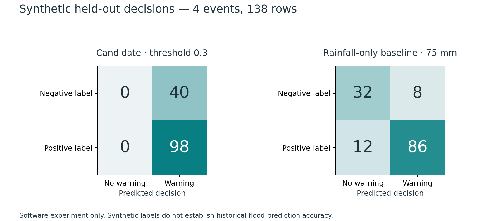
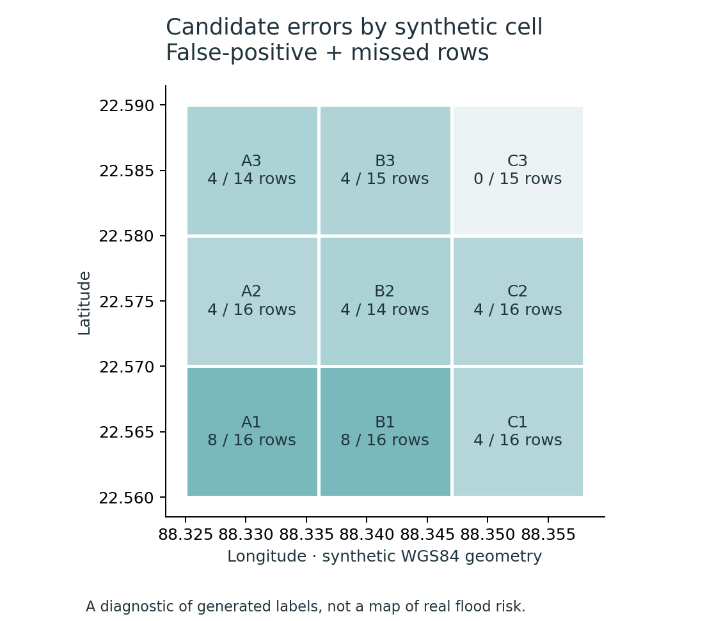

# Floodline: Smart City Flood Platform

Synthetic pilot implementation and acceptance report · 11 November 2026 · v0.1.0

## Problem and agreed scope
The supplied assignment asks for environmental-data analysis, GIS risk visualization, modelling against available historical evidence, community reports, alerts and route suggestions. The user approved a synthetic pilot and chose to lead with the map and ward evidence. The delivered system follows the supplied P1–P8 implementation pipeline.
No real pilot, observations, licensed event ledger or independent historical labels were supplied. The Week 2 feasibility gate therefore selects a susceptibility/threshold prototype. Historical forecasting accuracy is not established; synthetic demonstrations do not establish city-wide prediction or official emergency guidance.

## Source and implementation review
The supplied assignment (project description.docx, item 3) and the implementation pipeline define the requirements. The source register distinguishes the project-authored synthetic fixtures from possible future IMD, India-WRIS/CWC, NASA IMERG, Open-Meteo, municipal and OpenStreetMap inputs. None of those candidates supplies observations or event labels to this release. Coverage, time semantics, resolution, licence and actual access must be inspected before a real adapter is accepted; a nearby rainfall pixel or river gauge cannot establish flooding on a particular road.
FastAPI's documented schema/access patterns, Leaflet's map/layer interfaces and scikit-learn's preprocessing/evaluation conventions guide implementation. Their documentation is an implementation reference, not evidence of flood-prediction accuracy. The model card records the composite warning rule, and the source register records fixture provenance and candidate-source limitations.

## Interdisciplinary reasoning and architecture
Computer science contributes storage, APIs, reproducible experiments and failure handling. Geography contributes coordinate systems, spatial joins and bounded road graphs. Civil-engineering concepts motivate drainage and imperviousness features, while meteorological reasoning requires correct rainfall intervals, receipt time and gauge datum. Disaster-management principles motivate plain-language uncertainty, expiry and the separation of reported conditions from future risk. The civil and meteorological values here are synthetic assumptions, not field measurements or expert-endorsed thresholds.
The modular flow is raw archive -> validated observations -> issue-time geographic features -> versioned baseline -> map and area evidence -> consent-based alert decisions. A separate report stream goes through private submission and authenticated review before creating a bounded road-edge restriction. Durable decisions, audit records and delivery attempts connect these streams; reports do not automatically become training labels. FastAPI serves the React/Leaflet build, and one worker checks processing every 30 seconds. Architecture and API-contract documents describe the service boundaries and storage entities.

## Data and GIS
The reproducible fixture contains three wards, nine approximately 1 km cells, 21 nodes and 61 directed road edges. Geographic display uses WGS84; distances and spatial checks use UTM zone 45N. Roads include one-way and disconnected cases. Terrain, rainfall, gauges, drains and reports are invented and visibly labelled.
The raw archive has 869 records. Initial ingestion accepts 866, ignores one exact duplicate and quarantines two invalid records. Receipt time prevents delayed observations from leaking into an earlier issue-time feature snapshot. Units are converted explicitly and missing intervals remain missing. SHA-256 manifests freeze source inputs.

## Application and community evidence
FastAPI and SQLite provide the tested local service. React, TypeScript and Leaflet provide the map/evidence dashboard, report form, route planner, subscriptions and moderator review. An optional PostgreSQL/PostGIS adapter and container preparation exist but have not been executed on this machine.
Resident sessions own private pending text/image reports. Images are validated, oriented, stripped of metadata and re-encoded. Moderator authentication, a documented reason, spatial matching and explicit privacy review control verification and publication. Verified current hazards exclude specific directed edges; unreviewed reports and coarse warning cells cannot close a road.
Alerts require ward consent. Persistent decisions enforce idempotency, cooldown, severity escalation, bounded retries and expiry. Withdrawal, stale or superseded risk and resolved hazards stop queued delivery. The adapter is simulated and sends no real email or SMS.

## Baseline and separate model experiment
The active demo-threshold-v1 rule combines synthetic static susceptibility with recent rainfall. Required stale or incomplete rainfall makes the current index null and the area unknown. A gauge affects evidence support and context, not road-water depth or this numerical warning index. A three-hour maximum validity is not a validated forecasting horizon.
The separate software experiment uses 18 synthetic storms, 624 usable rows and chronological event-separated blocks: 10 training events (345 rows), 4 validation events (141 rows), and 4 test events (138 rows). Positive onset timestamps lie after issue time within the three-hour target window. Training-only preprocessing and validation-only F2 threshold selection precede the frozen final test.
| Method | Recall | Precision | False-positive rows | Missed positive rows |
| --- | --- | --- | --- | --- |
| Logistic candidate (0.3) | 1.0 | 0.7101 | 40 | 0 |
| Rainfall-only (75 mm) | 0.8776 | 0.9149 | 8 | 12 |

At the chosen 0.3 threshold, the candidate flags all 138 held-out rows: 98 true positives and 40 false positives. Its higher recall comes with a much larger false-positive burden than the rainfall-only comparator. That result is not a basis for promotion. Repeated false-positive rows are decision opportunities, not distinct delivered messages.
All labels in these tables are synthetic. Four test storms cannot support stable calibration, uncertainty intervals or a real-world accuracy claim. The candidate artifact remains explicitly unpromoted.

## Failure handling and acceptance
The backend acceptance suite passes 44 tests covering quality checks, temporal availability, privacy/access, upload validation, processed-image retention, moderation, road snapping, directed exclusions, consent, retries, staleness, expiry, worker-failure recovery, restore and rollback. Browser acceptance passes 13 flow checks with 31 captured states across desktop, tablet and phone sizes and no uncaught JavaScript errors.
The route demonstration excludes a newly verified segment and returns different edges. Both alternatives have the same 4444.9 m distance because the fixture contains tied routes. Feed outage preserves issue times and makes all nine cells unknown; synthetic recovery restores current evidence without pretending real missing observations were recovered.
The production build and an offline clean frontend install pass. The frontend dependency audit reports zero known vulnerabilities at the recorded check. The Windows launcher prepares the local application successfully. Clean online Python installation and PostgreSQL/container deployment could not be verified under the local network/tool availability.
A local test with 10 concurrent clients and 20 dashboard requests measured median 42.195 ms and p95 50.37 ms. This excludes upstream/provider latency and does not establish city-scale capacity.

## Delivery and remaining evidence gates
The package includes source, migrations, pinned dependencies, configuration, fixture/checksum records, event/split/error evidence, model card, API schemas, test logs, screenshots, launcher, runbook and contribution template. Original assignment and planning documents are preserved.
M1–M6 remain proposed roles. Names, course deadline, actual hours, peer sign-offs and human usability outcomes must be completed by the team. A real pilot needs source/licence review, credible historical positives and negatives, event/receipt-time audits, field/GIS review, human language/accessibility checks and a separate promotion decision. The delivered synthetic software path is usable now; these real-world gates remain open.

## Reference starting points
Provided requirements: project description.docx, item 3; outputs/Smart_City_Flood_Prediction_CAA_Pipeline.md. Implementation references: FastAPI documentation (https://fastapi.tiangolo.com/), Leaflet reference (https://leafletjs.com/reference.html), scikit-learn model evaluation (https://scikit-learn.org/stable/modules/model_evaluation.html), PostGIS documentation (https://postgis.net/documentation/) and OWASP file-upload guidance (https://cheatsheetseries.owasp.org/cheatsheets/File_Upload_Cheat_Sheet.html).
Candidate real-data references, not datasets used in this release: IMD (https://mausam.imd.gov.in/), India-WRIS (https://indiawris.gov.in/wris/), NASA IMERG (https://gpm.nasa.gov/data/imerg), Open-Meteo documentation (https://open-meteo.com/en/docs) and OpenStreetMap copyright (https://www.openstreetmap.org/copyright). Current access and suitability remain unverified. The source register and third-party notices accompany the package.
