# Floodline user guide

Version 0.1.1 · 12 November 2026

[Printable PDF](../outputs/Floodline_User_Guide.pdf) · [Editable Word document](../outputs/Floodline_User_Guide.docx)

Floodline is a working local synthetic CAA prototype. This guide explains what it does, how to use every screen, how it was built and what is complete or still pending.

> All pilot locations, environmental observations and event labels are invented. The relative warning index is not a validated flood probability. Alerts use a simulated in-app adapter.

## Contents

- [01. What Floodline can do](#01-what-floodline-can-do)
- [02. Start and stop the app](#02-start-and-stop-the-app)
- [03. Find your way around](#03-find-your-way-around)
- [04. Read the flood map](#04-read-the-flood-map)
- [05. Understand warnings and time](#05-understand-warnings-and-time)
- [06. Submit a waterlogging report](#06-submit-a-waterlogging-report)
- [07. Track, correct or withdraw](#07-track-correct-or-withdraw)
- [08. Find a route](#08-find-a-route)
- [09. Subscribe to ward alerts](#09-subscribe-to-ward-alerts)
- [10. Sign in and review evidence](#10-sign-in-and-review-evidence)
- [11. Restrict or resolve a road](#11-restrict-or-resolve-a-road)
- [12. Run a synthetic scenario](#12-run-a-synthetic-scenario)
- [13. A guided practice exercise](#13-a-guided-practice-exercise)
- [14. Inspect data and the model](#14-inspect-data-and-the-model)
- [15. How the app was made](#15-how-the-app-was-made)
- [16. How far it is completed](#16-how-far-it-is-completed)
- [17. Remaining work and future uses](#17-remaining-work-and-future-uses)
- [18. Mobile, access and privacy](#18-mobile-access-and-privacy)
- [19. Troubleshooting](#19-troubleshooting)
- [20. Reference and glossary](#20-reference-and-glossary)

First-time resident: 02–09. Moderator: 10–13. CAA presenter/assessor: 01 and 14–17. Troubleshooting and reference: 18–20.

## 01. What Floodline can do

A community flood-awareness and risk-analysis prototype for the CAA assignment.

Floodline brings environmental observations, a geographic map and reviewed community reports into one browser app. It helps users inspect area evidence, report waterlogging, receive ward updates and compare routes around known road restrictions.

> **Current scope.** The Riverside demo catchment, its place names, rainfall, gauges, terrain, roads and event labels are invented. Version 0.1.1 is a working local synthetic prototype. Its relative warning index has no established real-world forecasting accuracy.

| User | What they can do now |
| --- | --- |
| Resident | Read the map and data; submit and manage their own observations; opt in to ward alerts; request a route. |
| Moderator | Review all reports, record decisions, publish reviewed images, create or resolve road restrictions and inspect operations. |
| CAA team / assessor | Demonstrate the data-to-action pipeline, examine its evidence and explain its limitations and remaining work. |
| Future municipal pilot | Could use licensed local data and reviewed reports for awareness after the real-data, validation and deployment gates are completed. |

### Practical uses today

- Demonstrate how missing or delayed environmental data affects a warning.
- Practise the resident-to-moderator reporting workflow without visiting a flooded road.
- Show how a verified restriction changes a directed route.
- Study consent, alert expiry, retries, data provenance and transparent model evaluation.

The current app is suitable for learning, assessment demonstrations and prototype testing. Emergency decisions and actual street conditions require authoritative local information and real evidence.

## 02. Start and stop the app

Windows quick start for the supplied working folder or bundled demo ZIP.

### Before you start

- Extract a demo ZIP before launching it. Keep start.bat, backend, frontend and data together in the project folder.
- Install Python 3.12 or newer. Internet is needed if Python dependencies must be downloaded for the first setup.
- Use a modern browser; Edge and Chrome were used for verification. The bundled interface runs without Node, npm, API keys or PostgreSQL.

1. Double-click start.bat in the project folder. Or open PowerShell there and run the command below.
2. Leave the launcher window open while it checks dependencies, prepares the database, runs the synthetic evaluation and starts the server.
3. The dashboard opens when ready. The usual address is http://127.0.0.1:8000. If that default port is busy, use the address printed by the launcher.
4. Start as a resident; no resident registration form is needed. Follow the next page to choose a screen.
5. To stop the app, return to the launcher window and press Ctrl+C. Closing only the browser tab does not stop the server.

```powershell
.\start.bat
```

| Situation | Command or action |
| --- | --- |
| Retry dependency setup | .\start.bat -Install |
| GitHub source clone or edited interface | Install Node 22.12+ and npm; run .\start.bat -Rebuild once. |
| Choose a specific port | .\start.bat -Port 8001 |
| Prepare without serving | .\start.bat -PrepareOnly |
| Prevent automatic browser opening | .\start.bat -NoBrowser |

> **What is retained.** Ordinary startup preserves reports and subscriptions and backs up an existing SQLite database. It also retains the demo clock. A previously used runtime can reopen with stale observations; see the replay instructions.

A source-only GitHub clone needs an initial frontend build. On macOS or Linux, follow the manual setup in README.md; the Windows batch launcher does not apply there.

## 03. Find your way around

The navigation uses the same six screens on desktop and narrow screens.

| Navigation label | Use it for |
| --- | --- |
| Flood map | Current demo warnings, area evidence, rainfall history and verified road hazards. |
| Reports | Submit, correct or withdraw your observations; read current verified community reports. |
| Route suggestions | Choose landmarks and find a route around active verified restrictions. |
| Your alerts | Give ward consent, read simulated delivery history or unsubscribe. |
| Data & model | Inspect environmental sources, the active rule and the model promotion gate. |
| Evidence review | Moderator sign-in, report decisions, replay controls, health and audit history. |

### Desktop, phone and appearance

On desktop, choose a screen from the left sidebar. On a narrow screen, use the menu button in the top right; choose a screen or close the navigation with its X button. The menu also contains moderator access and Appearance.

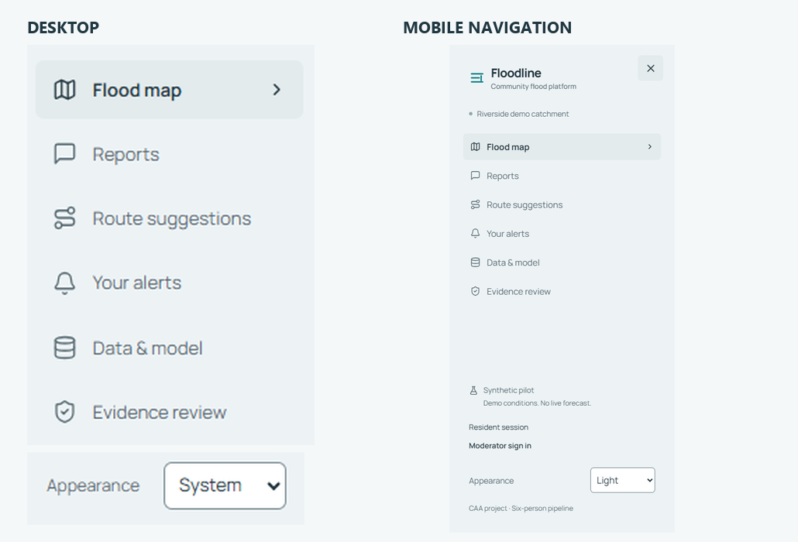

*Desktop navigation and the mobile menu show the same screen labels.*

Appearance offers System, Light and Dark. System follows your device. A manual choice is remembered when browser storage is available and synchronizes between tabs. The moon/sun button in the header switches directly between Light and Dark.

> **Know which session you are using.** The navigation says Resident session or Moderator. Use Return to resident after a review; it ends moderator access while retaining the existing resident session.

## 04. Read the flood map

Begin with the summary, then inspect the evidence for one analysis area.

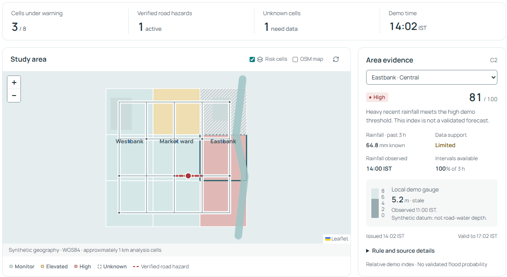

*Flood map: summary above, Study area on the left and Area evidence on the right.*

1. Open Flood map. Read Cells under warning, Verified road hazards, Unknown cells and Demo time.
2. Select a colored cell in Study area, or use the area selector at the top of Area evidence. The selector is the text and keyboard alternative to choosing a map cell.
3. Read the risk word, relative index, known rainfall, Data support, observation time and available intervals.
4. Expand Rule and source details to see the rule version, reasons and spatial support. Check Issued and Valid to as well as observation freshness.
5. Scroll to Rainfall history and Observed waterlogging. These explain environmental history and separate current reviewed observations.

Risk cells toggles the colored layer. OSM map optionally loads online OpenStreetMap tiles; the synthetic map works without those tiles. Use + / − to zoom and drag to move the map. The refresh icon requests current app data.

> **Fresh starting example.** A new runtime has 9 cells: 3 warnings among 8 evaluated cells, 1 unknown cell and 1 active verified hazard. The denominator excludes unknown cells. Used runtimes and replay scenarios can show different totals.

## 05. Understand warnings and time

Read the words and data support together; the 0–100 index is relative.

| Risk word | Meaning in this demo | How to interpret it |
| --- | --- | --- |
| Monitor | Current supported index is below 55. | The threshold is not met; unreported waterlogging may still exist. |
| Elevated | Index is 55–74. | Rainfall and synthetic susceptibility meet the elevated demo rule. |
| High | Index is 75 or above. | The high demo rule is met. This is not a validated flood probability. |
| Unknown | Missing, insufficient, stale or expired evidence; current index is absent. | Read the reason and last observation time; do not interpret missing data as low risk. |

| Data support | What it means |
| --- | --- |
| Adequate | Fresh rainfall has nearly complete required coverage and the contextual gauge is current. |
| Limited | Rainfall is incomplete or older, or the contextual gauge is missing/stale. |
| Insufficient | A reliable current interpretation cannot be made. |

### Four times to distinguish

- Demo time: the synthetic clock used for evidence age, report validity and replay.
- Observed: when a measurement or reported condition occurred.
- Issued: when the contributing evidence became available to the app.
- Valid to / expires: the maximum validity of an update; staleness can invalidate it earlier.

Rainfall older than 90 minutes, or under 75% of expected three-hour intervals, produces Unknown. A risk record has at most three hours of validity. That lifetime is not a validated three-hour forecast. Gauges older than 60 minutes are marked stale.

> **Time entry and units.** The app displays IST. Observed at in the report form uses your device's local timezone and is converted to UTC. Keep the prefilled demo time for practice. Rainfall is in mm; the synthetic gauge is in m and is not road-water depth.

Approximately 1 km analysis cells cannot describe the water depth or condition of an individual street. Only separately reviewed road evidence changes route exclusions.

## 06. Submit a waterlogging report

Use Reports or the Report waterlogging button on the map.

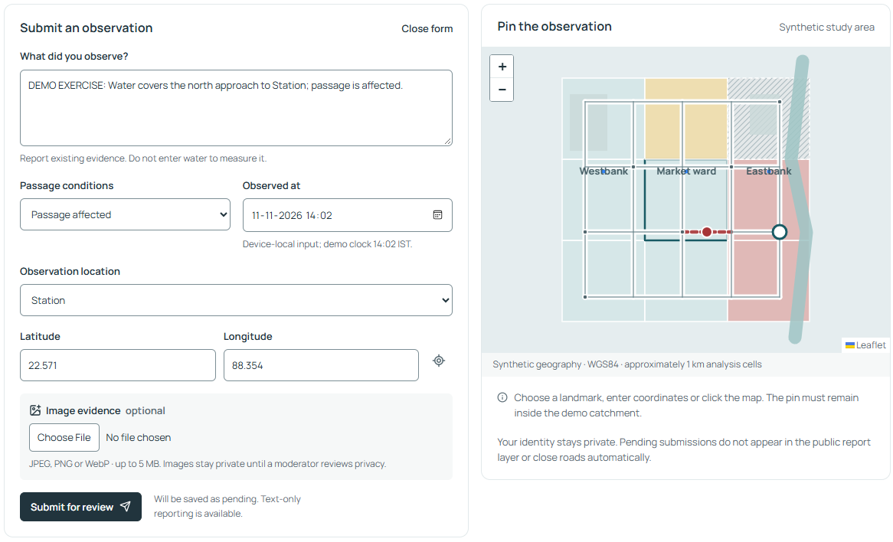

*A training observation at Station, with passage conditions and a pin inside the demo catchment.*

1. Open the form. If the report list is showing, choose New report or Submit another observation.
2. Enter What did you observe? Use 10–800 characters describing the location, condition and effect on passage.
3. Choose Passage conditions: Water on road, Passage affected, Road impassable or Severity uncertain.
4. Check Observed at. Use the displayed demo clock for the exercise; the app accepts the last 24 demo hours and at most 5 minutes ahead.
5. Choose an Observation location landmark, enter Latitude and Longitude, or click the map. Confirm that the pin is inside the synthetic study area.
6. Optionally attach a JPEG, PNG or WebP image, up to 5 MB and 12 megapixels. Then choose Submit for review.
7. Wait for Report saved as pending. Your reports shows the saved observation. If an image upload fails, the text can still be saved; read the confirmation before submitting again.

> **A useful training description.** DEMO EXERCISE: Water covers the north approach to Station; passage is affected. This is invented training evidence.

Device location requires browser permission and may be outside the invented catchment. A demo landmark is usually the practical choice. Pending reports and images are private; they do not close roads automatically.

## 07. Track, correct or withdraw

Your reports belongs to the current browser's resident session.

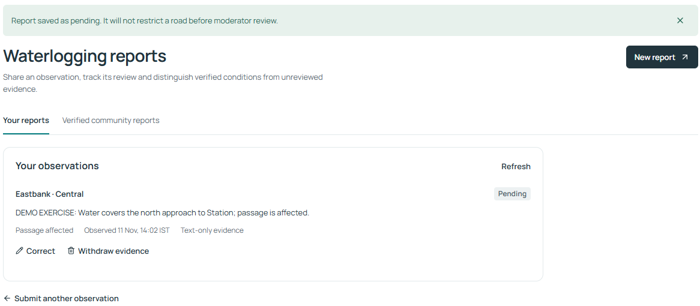

*The saved report appears under Your reports with its review state and management actions.*

1. In Reports, close the form if necessary and choose Your reports. Use Refresh to request the latest state.
2. To change a pending description, choose Correct, edit the text and select Save correction. The interface corrects description only.
3. To remove your evidence, select Withdraw evidence, read the confirmation and choose Withdraw report. Keep report cancels that action.
4. Use Verified community reports to read current published observations. Open View image evidence when a permitted image is available.

| State | Meaning |
| --- | --- |
| Pending | Saved privately and awaiting a moderator decision; it creates no automatic road restriction. |
| Verified | Moderator accepted the observation. A restriction exists only if one was separately selected in that review. |
| Rejected | The review did not support acceptance; read the recorded reason. |
| Duplicate | Linked to another pending or verified observation. |
| Resolved | A moderator recorded resolution of a verified observation and its linked restriction. |
| Expired | The evidence is outside its validity window; it no longer counts as current verified evidence. |

> **Withdrawal and session access.** Withdrawal removes your report text and image immediately. A separately reviewed restriction retains its own validity until moderator resolution or expiry. Browser cookies identify your session; another browser, cleared cookies or session expiry can remove access to the original resident's records.

## 08. Find a route

Route suggestions uses a small directed road graph and current verified exclusions.

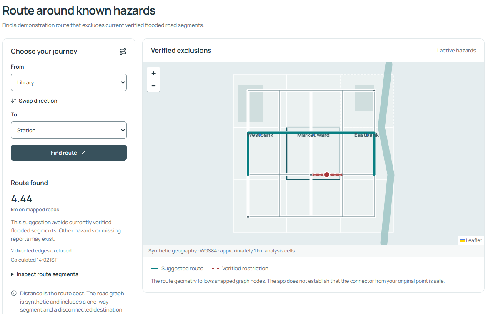

*Library → Station: the result shows mapped distance, excluded edges and calculation time.*

1. Open Route suggestions. Choose a landmark in From and another in To; Library and Station are a useful first example.
2. Select Find route. If a route exists, read Route found, the distance in km, excluded-edge count and Calculated time.
3. Inspect the colored route and dashed verified restrictions on the map. Open Inspect route segments for a text list of mapped segments.
4. Use Swap direction to reverse the journey, then select Find route. One-way roads can make directions differ.
5. After a moderator changes a restriction, calculate the journey again. A requested route also refreshes when the app receives changed hazard data.
6. Try Disconnected demo point as the destination. Route unavailable is a valid result when the graph has no permitted connection.

> **What the route result establishes.** The route minimizes mapped distance and avoids active verified hazard edges. It gives no travel time, transport-mode filtering, turn-by-turn navigation or guarantee that an unreported road is clear. The connector from an original location to a snapped node is not assessed for safety.

A High risk cell or an unreviewed report does not automatically close a road. In the default graph, a new restriction can change the route segments while the distance stays the same because alternative paths can have tied lengths.

## 09. Subscribe to ward alerts

Your alerts is an opt-in, simulated in-app history for your current session.

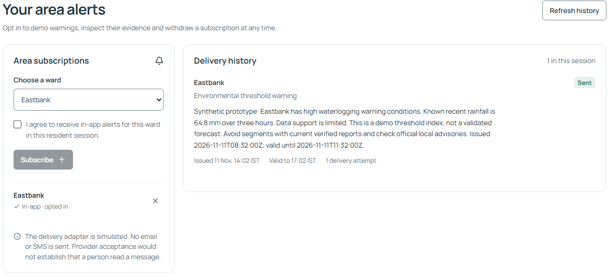

*Area subscriptions holds consent and ward choice; Delivery history holds issued messages and their validity.*

1. Open Your alerts and choose a ward under Area subscriptions.
2. Tick I agree to receive in-app alerts for this ward in this resident session. Subscribe becomes available only after consent.
3. Select Subscribe. Confirm that the ward appears as In-app · opted in. Repeat for another ward if needed.
4. Read Delivery history. Distinguish Environmental threshold warning from Observed, reviewed road hazard. Check issue time, Valid to, attempts and any stale-evidence message.
5. Use Refresh history for an immediate update. If there are no alerts, confirm that consent is active and the ward currently has an eligible warning or reviewed hazard.
6. To opt out, use the X beside the subscribed ward. Queued deliveries for that subscription are cancelled.

| Delivery state | Meaning |
| --- | --- |
| Queued / Sent | Waiting for processing / accepted by the simulated adapter. Sent does not mean a person read a message. |
| Failed | A simulated attempt failed; inspect attempts and any next retry. |
| Expired / Cancelled | Validity ended / delivery stopped because consent or supporting evidence changed. |

> **Current notification channel.** No SMS, email, browser push or native phone notification is sent. Updates appear inside this app. Refreshing a page does not create a new weather observation or require repeated consent.

## 10. Sign in and review evidence

Evidence review is restricted to moderators and records decisions in the audit trail.

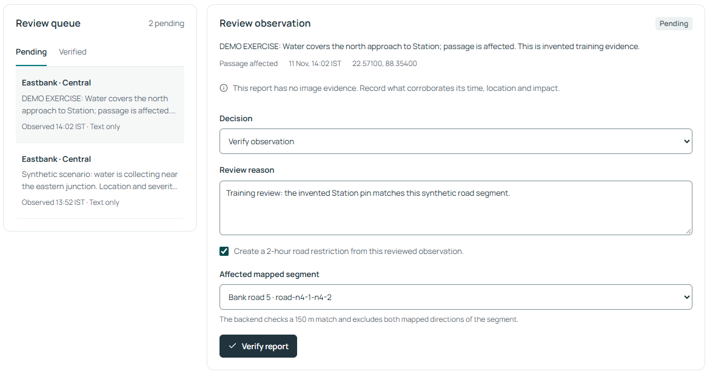

*Select a queued report, inspect its evidence and record the reason for a decision.*

1. Open Evidence review and choose Moderator sign in. The sidebar also provides the sign-in action.
2. For a new default local demo, enter username moderator and password floodline-demo, then choose Sign in. Configured accounts can differ.
3. Use Pending to choose a queued observation. Read its description, passage condition, observed time and latitude/longitude.
4. Inspect any private image using Open full evidence image. Check what supports the report's time, place and reported impact.
5. Choose Verify observation, Reject evidence or Mark as duplicate. Enter a Review reason of 10–500 characters.
6. For a duplicate, choose a different existing pending or verified observation. Submit using the button that matches your decision.
7. Confirm Review recorded, then inspect the queue, map and Recent audit trail. Use Return to resident in the navigation when finished.

> **Image publication is a separate choice.** Verification can publish the report text without publishing its image. If an image is present, inspect identifying people, plates and sensitive details; explicitly confirm privacy review before choosing Publish the privacy-reviewed image. Leaving publication unchecked keeps the image private.

Review permissions require an authenticated moderator session. The default credentials are for the local demo; ask the setup owner for configured credentials if sign-in fails.

## 11. Restrict or resolve a road

A verified report and a mapped road restriction are related but separate decisions.

### Create a restriction during verification

1. Select a pending report in Evidence review and choose Verify observation with a supporting Review reason.
2. Tick Create a 2-hour road restriction from this reviewed observation only when the evidence supports the affected segment.
3. Choose Affected mapped segment. Nearby segments are listed first; the backend enforces a match within 150 m of the report pin.
4. Choose Verify report. If the match is rejected, read the error and correct the location/segment evidence; the rejected transaction does not partially create a restriction.
5. Return to Flood map and Route suggestions. The active hazard count and affected road exclusions update; recalculate the same journey.

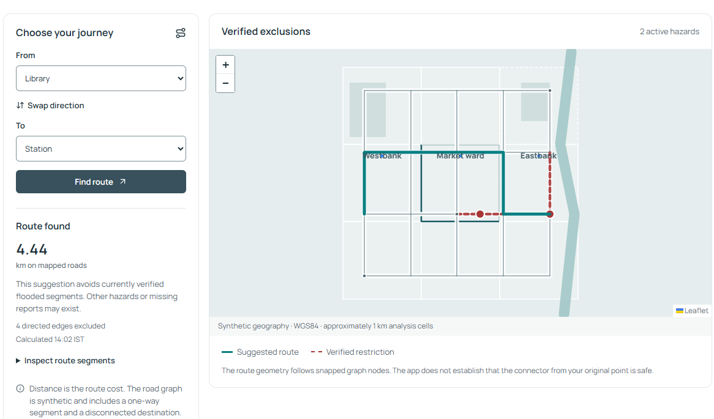

*After the Station north-approach restriction is verified, Library → Station uses different permitted segments.*

The standard interface requests 120 minutes of reviewed validity, capped by the report's observation age. Restrictions exclude the mapped directed edges for the selected physical segment. A pending report alone never excludes an edge.

### Record resolution

1. Choose Verified in the review queue, select a current report and choose Resolve verified hazard.
2. Enter a supporting reason, select Record resolution and confirm the updated hazard count and route.

> **Expiry is not proof that a road cleared.** Restrictions stop affecting the graph when resolved or expired. The absence of a current restriction does not establish current street conditions. Withdrawal of a resident's evidence does not itself resolve an independently reviewed hazard.

## 12. Run a synthetic scenario

Moderator replay controls demonstrate changed rainfall, outages and delivery processing.

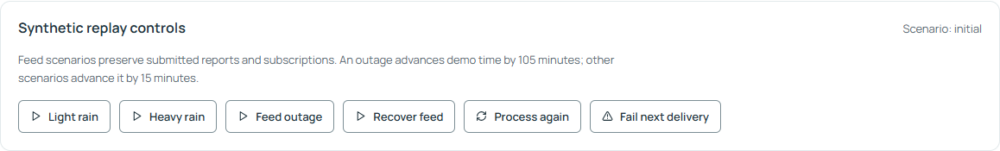

*Synthetic replay controls are below the report review form. Use them deliberately during a demonstration.*

| Control | What happens | What to inspect |
| --- | --- | --- |
| Light rain | Adds synthetic observations and advances demo time by 15 min. | Supported lower-rainfall interpretation and current times. |
| Heavy rain | Adds synthetic heavy rain; advances by 15 min. | Updated indexes and eligible ward warnings. |
| Feed outage | Adds no rainfall; advances by 105 min. | Retained issue times, Unknown cells and stale evidence. |
| Recover feed | Creates a new synthetic history; advances by 15 min. | Current support returns; actual missing weather history is not recovered. |
| Process again | Processes eligible decisions, expiry and retries without adding evidence. | Unchanged triggers are deduplicated; counts need not increase. |
| Fail next delivery | Makes the next simulated delivery attempt fail once. | Failed state, attempt count and bounded retries. |

To demonstrate a failed send, first keep a resident subscribed to a ward, configure Fail next delivery, then create a new eligible trigger with Heavy rain. Inspect that resident's Your alerts. A failure flag is consumed only when a delivery is actually attempted.

Retries are due after 30 seconds and then 60 seconds, with at most 3 attempts. The worker processes due work roughly every 30 seconds while the app runs. Unchanged warning reminders have a 30-minute cooldown; severity escalation can bypass it.

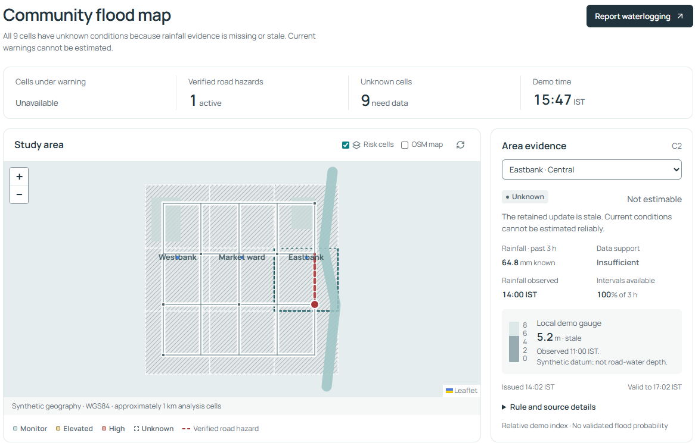

*An outage shows Unavailable warnings and all nine cells Unknown; the map retains its source timing.*

> **Keep the exercise interpretable.** Scenarios preserve reports and subscriptions, but time advances can expire them. Use a fresh rehearsal runtime for a predictable starting state. Repeated Process again is not a new weather feed.

## 13. A guided practice exercise

Allow about 10–15 minutes. Use only explicitly invented training evidence.

| Step | Action | Expected result |
| --- | --- | --- |
| 1 · Inspect | Open Flood map; select an area and expand Rule and source details. | See the risk word, support, time and relative-index explanation. |
| 2 · Route | Find Library → Station; note the segments and mapped distance. | A permitted route appears around the seeded verified hazard. |
| 3 · Report | As resident, report invented waterlogging at Station using the current demo time. | Your reports shows Pending; no new road restriction exists yet. |
| 4 · Subscribe | Opt in to Eastbank (ward C) in Your alerts. | The subscription is active; eligible in-app records can appear. |
| 5 · Review | Sign in as moderator; review the training report and choose the Station north approach, road-n4-1-n4-2, if the pin supports it. | A reasoned verification creates the matched restriction; the audit trail changes. |
| 6 · Compare | Find Library → Station again and inspect its segments. | The route avoids the new restriction. Distance may remain equal. |
| 7 · Outage | Use Feed outage, then open Flood map. | All nine cells become Unknown; original issue times remain. |
| 8 · Recover | Use Recover feed, then return to resident and inspect map, report and alerts. | Synthetic current support returns; older evidence may have expired. |
| 9 · Explain | Describe one uncertainty message and one remaining project gate. | Show that the demonstration establishes software behavior, not real flood accuracy. |

### Prepare a separate rehearsal

For the expected fresh state, use an unused runtime folder in a new PowerShell window. This keeps the ordinary demo records. The environment choice applies to that window; choose a different folder name for another fresh rehearsal.

```powershell
$env:FLOODLINE_RUNTIME = '.runtime/guide-rehearsal-01'
.\start.bat
```

The new demo begins near 14:02 IST on 11 November 2026, then advances with elapsed time and replay. For the six-speaker CAA handoffs, follow docs/DEMO_RUNBOOK.md. Human testing and team rehearsal still need actual participant records.

## 14. Inspect data and the model

Data & model explains the active approach and the separate software experiment.

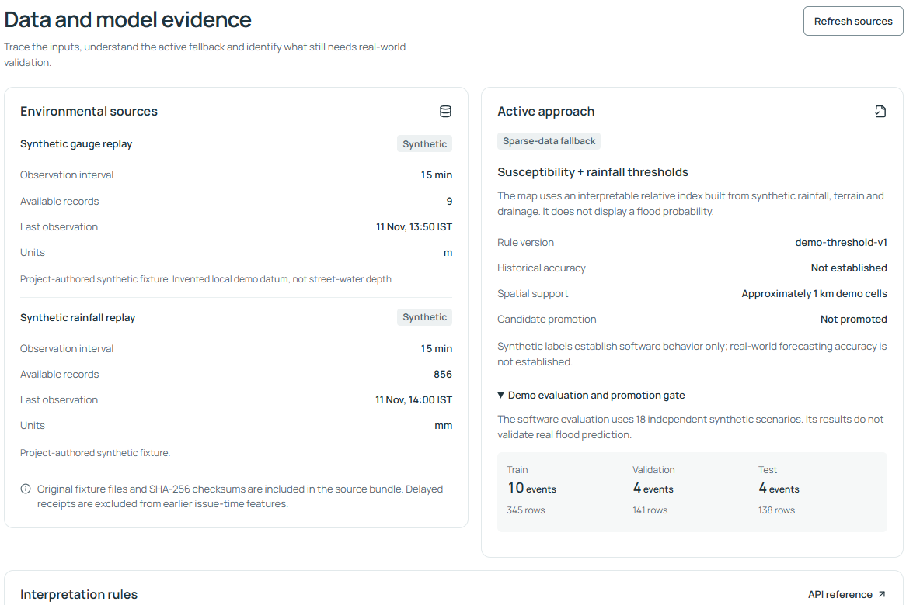

*Source interval, units and records are shown beside the active fallback and chronological evaluation split.*

1. Open Data & model. Read Environmental sources: name, Synthetic label, observation interval, available records, last observation and units.
2. Read Active approach. The running map uses Susceptibility + rainfall thresholds, rule demo-threshold-v1.
3. Expand Demo evaluation and promotion gate. Inspect the training, validation and test event groups and the Not promoted status.
4. Read Interpretation rules. Use API reference to inspect endpoint actions and OpenAPI schemas if you are studying the implementation.

### How the map index works

A static susceptibility score weights impervious surfaces, drainage constraint, relative elevation and distance to water. A rainfall score scales known three-hour rainfall against a 75 mm demo reference. The map index rounds 35% susceptibility plus 65% rainfall. The displayed gauge affects data-support context; it is not part of this numerical index.

> **Model experiment versus active behavior.** A separate logistic-regression experiment uses 18 synthetic storm groups and 624 usable decision rows, split chronologically into 10 / 4 / 4 events. Its candidate is unpromoted and is never loaded for the map's decisions. At its chosen threshold it flags all 138 held-out rows, including 40 false positives.

The synthetic experiment shows that evaluation and evidence export work. Historical predictive accuracy, calibration and a real model promotion decision need independent real event labels and licensed observations. Community reports do not automatically retrain a model.

## 15. How the app was made

The implementation follows the supplied CAA brief and eight-package P1–P8 plan.

The brief asks how limited environmental and geographic information can become understandable community flood information. The approved development scope used synthetic data because no trustworthy local historical labels or real pilot inputs were supplied. The result is a complete local workflow with explicit real-pilot gates.

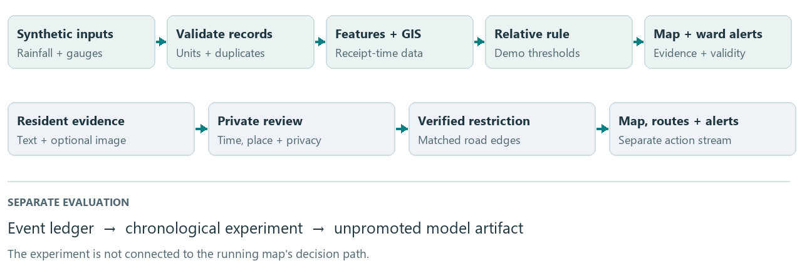

*Two evidence streams meet in the app: environmental thresholds and separately reviewed road observations.*

| Layer | Actual technology | Purpose |
| --- | --- | --- |
| Browser interface | React 19, TypeScript, Vite | Six screens, forms, session state and appearance preferences. |
| Map | Leaflet / React Leaflet | Versioned GeoJSON cells, road layers, pins and route geometry. |
| API and services | Python, FastAPI, Pydantic, Uvicorn | Validated requests, access, processing and app serving. |
| Local persistence | SQLite and numbered SQL migrations | Observations, reports, sessions, hazards, subscriptions, jobs and audit. |
| Geometry and routes | Shapely, PyProj, NetworkX | WGS84 display, projected distances, spatial matches and directed paths. |
| Evaluation and images | pandas, NumPy, scikit-learn; Pillow | Separate model experiment; decoded, resized and cleaned images. |

Build order: define scope and contracts → archive/validate observations → construct GIS and roads → implement the interpretable rule and evaluation → connect database/APIs → build resident/moderator screens → add alert and routing lifecycles → verify and package.

A transactional background cycle runs about every 30 seconds in one app process. It computes new risk records only when supporting evidence changes, expires old evidence and processes eligible alerts. It does not download a live weather feed. PostgreSQL/PostGIS and Docker files provide an optional, locally untested deployment path.

## 16. How far it is completed

Status reviewed for version 0.1.1 on 12 November 2026.

> **Completion statement.** The local synthetic prototype is implemented and automated checks pass. The CAA submission still needs human/team evidence. A live, historically validated flood service and hosted production deployment are incomplete. A single completion percentage would mix these different scopes.

| Capability | Status now | Evidence or remaining limit |
| --- | --- | --- |
| Synthetic observation pipeline | Implemented / tested | 866 initially accepted records; 1 duplicate ignored; 2 quarantined. Units, missing values and receipt times handled. |
| Map and area evidence | Implemented / tested | 3 invented wards, 9 approximately 1 km cells; evidence, source rules and Unknown states. |
| Community reports and images | Implemented / tested | Private pending reports, cleaned images, ownership, correction and withdrawal. |
| Moderator review | Implemented / tested | Verification, rejection, duplicate linking, resolution, privacy review and audit. |
| Routing | Implemented / tested | 21 nodes and 61 directed edges; verified exclusions, one-way roads and unreachable results. |
| In-app alert lifecycle | Implemented / tested | Consent, deduplication, cooldown, bounded retries, cancellation and expiry; simulated delivery. |
| Appearance / responsive UI | Implemented / automated checks | System, Light, Dark and recorded desktop/phone widths. Human usability work remains. |
| Model experiment | Implemented, unpromoted | Synthetic event-separated evaluation exists; real forecasting accuracy is not established. |
| Local launch / documentation | Implemented / tested | Windows launcher, bundled UI, evidence records, runbook, report and this guide. |
| Real pilot / deployment | Pending / partial preparation | Real data, field validation, historical testing, PostGIS acceptance, hosting and real providers still need work. |

The guide preparation reran all 44 backend tests successfully and completed 14 illustrated walkthrough checks with 16 fresh screen captures. Existing release records dated 11 November show 14 full browser workflow checks with 62 screenshots and 7 Windows launcher checks. Those full suites were not rerun solely for this guide.

These are software checks, not evidence of human usability, city-wide load, real sensor reliability or historical flood accuracy. See docs/ACCEPTANCE.md and outputs/_qa/user-guide/walkthrough.json for their exact scope.

## 17. Remaining work and future uses

Finish the evidence required for each claim before expanding the app's scope.

### Before the CAA team submits

1. Confirm the actual deadline and the instructor/team acceptance of the synthetic fallback.
2. Assign names to all six roles and record inspectable work, actual hours, peer reviews and individual reflections.
3. Run usability/accessibility tasks with five consenting people, including keyboard use and a real phone. Record success, errors and fixes; no measured human results exist yet.
4. Choose a relevant local language and obtain a fluent reader's review of one alert with uncertainty and expiry.
5. Have another team member reproduce setup, evaluation and the demo; rehearse the handoffs and failure cases.
6. Add that evidence to the report and contribution record, then sign off the submission release.

| Future function or use | What must be completed |
| --- | --- |
| Real catchment awareness | Choose a locality; license rainfall, gauges, ward boundaries and road data; validate geography and field matches. |
| Validated flood forecasting | Build reviewed historical event labels and supported negatives; evaluate separated real events; assess calibration and model promotion. |
| Real SMS / email | Integrate a provider with consent, delivery/retry/expiry evidence and operating credentials. This is an extension, not enabled now. |
| Shared hosted service | Complete database/deployment acceptance, HTTPS, configuration, backups, monitoring and coordination checks. |
| PostgreSQL / PostGIS | Run migration, spatial, API and restart acceptance against the prepared adapter and container setup. |
| IoT / native mobile / city scale | Optional later scope; add actual inputs or clients and validate coverage, reliability and load. |

> **Source publication and hosting.** The project records a public GitHub repository and synthetic prerelease downloads. Publishing source does not host the FastAPI app. The current delivered user workflow runs locally.

Use docs/REMAINING_TASKS.md for task IDs, proposed owners and the evidence that closes each item. Avoid assigning a finished status to a planned function simply because its configuration or experiment file exists.

## 18. Mobile, access and privacy

Use the text controls when the map or screen size makes a task difficult.

### On a narrow screen

- Open the top-right navigation menu to reach screens and appearance settings.
- Scroll to reach Area evidence below the map and the full report form.
- Use the area/landmark selectors instead of needing a precise touch on a map cell.
- The app is a browser interface. Opening a desktop's 127.0.0.1 address on a separate phone refers to the phone itself; shared access needs a separately configured host.

### Keyboard and readable evidence

- Use Tab and Shift+Tab to move through links, buttons, fields and selectors; visible focus marks the active control.
- The Skip to content link moves past repeated navigation. Use Enter/Space on focused controls as appropriate.
- Read the risk words, interval counts, evidence list and route segments alongside map colors.
- Automated checks cover widths of 1440, 1024, 390 and 320 pixels in both themes. Actual phone and human accessibility results still need the team's review.

### What the prototype stores

A resident session owns its reports, images, subscriptions and alert history. The default session lifetime is 12 real hours. Cookies identify that session; clearing them or moving to another browser creates a different access context. Moderator sign-out retains the existing resident cookie.

| Record | Current handling |
| --- | --- |
| Pending reports / images | Visible to the owning session and authenticated moderators; not in the public layer. |
| Published observations | Current verified text is public; image publication additionally requires an explicit moderator privacy review. |
| Image uploads | Decoded, oriented, resized and re-encoded; original files and EXIF metadata are not retained. |
| Image retention | Processed images are removed on a running processing cycle after 30 demo days; report text is retained unless withdrawn. |
| Withdrawal / audit | Text and image evidence is removed immediately; audit references and a separately reviewed restriction retain their own lifecycle. |

> **A future human-data pilot.** The 30-demo-day image cleanup is prototype behavior. Real participant consent, retention periods and approved communication wording need their own policy and review.

## 19. Troubleshooting

Read the message shown by the app or launcher, then use the matching action.

| Problem | Likely explanation / next action |
| --- | --- |
| Launcher fails or does not open the browser | Read the retained error window and .runtime/launcher-logs/. Install Python 3.12+ if missing; retry dependencies with start.bat -Install. Open the printed URL if the server is ready. |
| Interface build is missing | A source clone needs Node 22.12+ and npm. Run start.bat -Rebuild. The bundled demo normally avoids this step. |
| Port or address mismatch | Use the URL printed by the launcher. A busy default port is changed automatically; a busy explicitly requested -Port reports an error. |
| All warnings are Unavailable / Unknown | The retained rainfall is stale, insufficient or expired. Inspect times and reasons. In the demo, an authenticated moderator can deliberately use Recover feed. |
| OSM background tiles do not appear | Online tiles need internet. Untick OSM map to use the supplied synthetic geography. |
| Location sharing fails / pin rejected | Device location may be denied or outside the invented area. Choose a demo landmark or an inside-area pin. |
| Observation time rejected | Use the current demo clock converted to device-local input. The window is the last 24 demo hours to 5 minutes ahead. |
| Text saved but image failed | The text report already exists. Inspect Your reports before retrying. Image input must be JPEG/PNG/WebP, at most 5 MB and 12 megapixels. |
| No alerts or no new duplicate alert | Check active ward consent and eligible evidence. Use Refresh history. Repeated processing deduplicates unchanged triggers; failed sends wait for due retries. |
| Cannot edit or cannot find old own reports | Only pending descriptions can be corrected. Use the original browser/session; cookies or the 12-hour session may have expired. |
| Moderator login / road match rejected | Use configured credentials and a permitted decision. A selected restriction must match the report pin within 150 m; choose the supported segment. |
| Route unavailable / unchanged distance | No permitted graph connection may exist. A changed path can have the same distance. Inspect its segments and exclusions rather than distance alone. |
| App cannot refresh / too many requests | Keep the server running and use Retry when available. Rate limits request a pause; avoid repeated rapid submission. |
| A report or alert expired after replay | Replay advances demo time. Read its original observation/issue and expiry; use new supported training evidence where appropriate. |

If unresolved, record the exact message, screen or command, printed server address and launcher log path. Give these to the team member responsible for backend/setup or the interface. No hosted support desk is implemented.

## 20. Reference and glossary

Use these project records for deeper evidence and operating details.

| Record | What it explains |
| --- | --- |
| README.md | Local launch, manual setup, verification and source/demo packaging. |
| docs/DEMO_RUNBOOK.md | Six-speaker demonstration, replay, backup, retention and optional deployment. |
| docs/PROJECT_STATUS.md / REMAINING_TASKS.md | Implemented packages, open submission tasks and real-pilot gates. |
| docs/MODEL_CARD.md / DATA_DICTIONARY.md | Exact threshold rule, data fields, time semantics and evaluation limits. |
| docs/ARCHITECTURE.md / API_CONTRACTS.md | Services, storage, access roles and integration contracts. |
| docs/ACCEPTANCE.md / TEAM_CONTRIBUTIONS.md | Recorded checks; team names, human evidence and reflections still to fill in. |
| Running app: /docs and /openapi.json | Offline endpoint reference and complete generated schemas at the app's actual address. |

| Term | Plain meaning |
| --- | --- |
| Ward / analysis cell | An administrative grouping / a geographic unit for the demo's risk interpretation. |
| Susceptibility | Relative terrain and drainage conditions that can make an area more vulnerable. |
| Threshold / calibrated probability | A configured rule cut-off / a statistically validated chance estimate. The app uses the former. |
| Provenance / quarantine | Where evidence came from / holding invalid records with the reason they were rejected. |
| Directed edge / hazard | A permitted direction along a road / a reviewed, time-limited restriction tied to road edges. |
| Deduplication / cooldown | Avoiding repeats of the same trigger / spacing unchanged warning reminders. |
| Candidate promotion | A reviewed decision to use an evaluated model for app decisions; this candidate is not promoted. |
| GIS / API | Geographic information processing / the interface through which the browser calls backend services. |

Guide basis: the supplied assignment's item 3, inspected application source, version 0.1.1 project records, a fresh 44-test backend pass and a new isolated illustrated walkthrough on 12 November 2026. Screen captures show invented training evidence and may differ from a runtime with another history.

Source repository recorded by the project: https://github.com/Godavenger/floodline-caa. Canonical readable guide: docs/USER_GUIDE.md. Printable guide and editable document: outputs/Floodline_User_Guide.pdf and outputs/Floodline_User_Guide.docx.

Guide build source: [shared content](../outputs/_build/user_guide/guide_content.py) and [document builder](../outputs/_build/user_guide/build_user_guide.py). Fresh screen walkthrough: [record](../outputs/_qa/user-guide/walkthrough.json).
